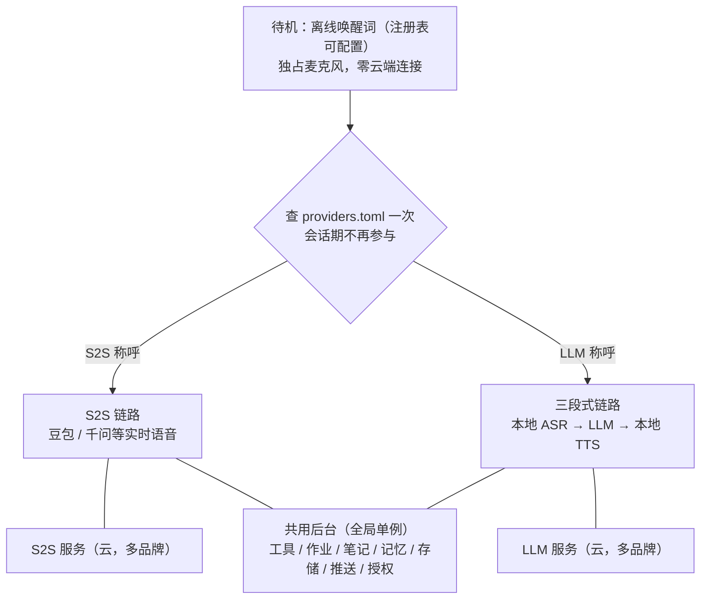
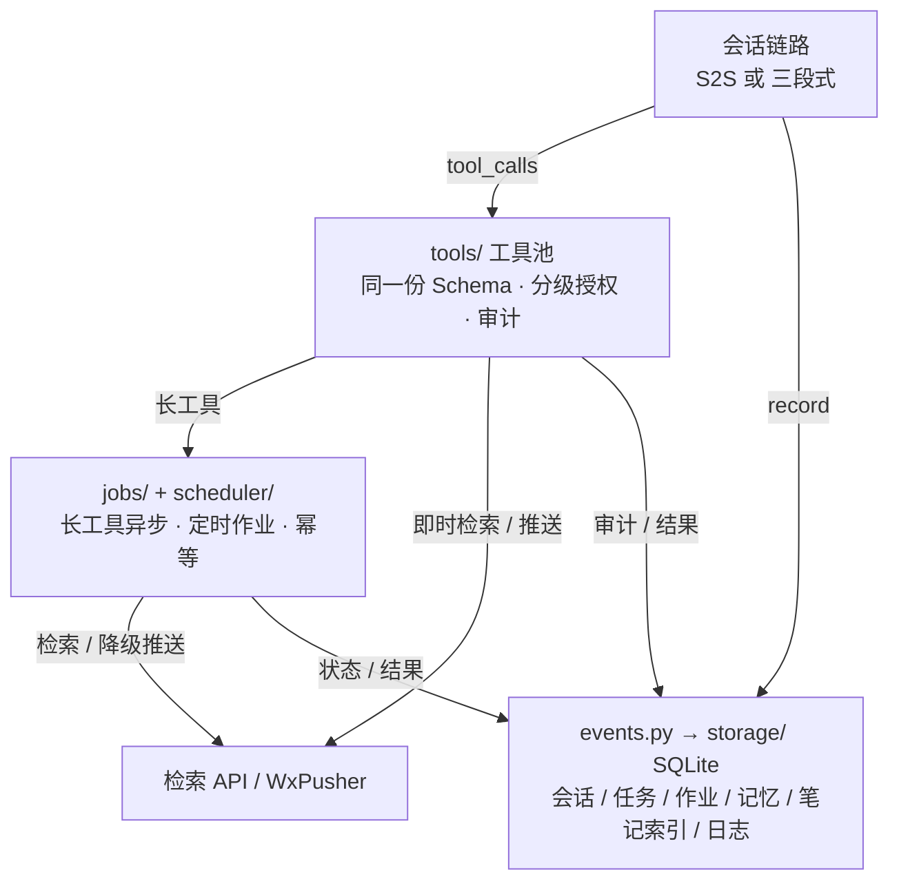

# 技术方案

给实现者的全景：目标架构、模型注册表、目录规范、阶段计划与验收门禁。需求口径见 [项目提案](proposal.md)；接入前检查见 [接入前检查](preflight.md)。

依赖：

- S2S 实时语音服务：豆包 Seeduplex、千问 Omni 等
- OpenAI 兼容 LLM：DeepSeek、GPT 等
- Pipecat 子仓库：Frame 编排、本地音频 I/O；只读、pin commit
- 其余自研

豆包协议依据见 `preflight/s2s_doubao/` 内的官方 PDF。

## 一句话架构

常驻进程按**版本化的模型注册表**把唤醒词映射到 Provider，**唤醒即定链路、整场会话不变**；`s2s`（端到端实时语音）与 `llm`（ASR → LLM → TTS）两类通用 Pipeline 复用同一套全局单例后台。同一时刻只有一条会话运行，切换必须先停旧会话、释放资源。零入站端口，只主动出站。



箭头只表示唤醒时的一次选择，横线表示双向通信或复用。

图只回答三件事：

- 谁分流
- 两类链路各自连哪类云服务
- 哪些后台能力全局共享

具体品牌在注册表里，不画进图。主图里 `共用后台` 的内部见「共用后台展开」。

## 设计原则

1. **唤醒即定链路、整场不变**

   不做会话内模型切换、不按意图或负载调度、不做降级切换。想换模型必须结束当前会话再唤醒。

2. **注册表驱动**

   `config/providers.toml` 是唯一的「唤醒词 → 配置组 → Provider」路由表；加模型 = 加一条 + 一组 `.env` 配置 + 一个 preflight 目录。

3. **统一 Provider 契约（静态）**

   `app/providers/base.py` 固定 `start`、`stop`、`send_audio_frame`、`register_tools`、`is_running`，另有可选的 `cancel_response`（取消服务端进行中的回答，默认空实现）。不做 capabilities 协商、不做运行时发现、不做会话内切换。契约是为了让新增模型不动路由和后台，不是为了抽象而抽象。

4. **全局单例共享**

   ToolRegistry、Memory、Storage、Scheduler 全项目唯一，所有 Provider 复用；`memory_scope` 可切 `global` / `per_provider`。

5. **运行强互斥**

   同一时刻仅一条会话 Pipeline；新唤醒先停活跃会话、释放连接与音频设备，再启动新会话。

6. **先验后开发**

   每个模型的 `preflight/<链路>_<品牌>/` 自检未通过前，不得写业务适配层。

7. **配置零硬编码**

   私有值在 `.env`，结构在 `providers.toml`，业务代码里不出现密钥、模型名、端点或唤醒词。

8. **目录合规**

   收尾时做一次目录评审，违规立即整改；`pipecat/` 子模块只读。

## 模型注册表与配置分层

| 文件 | 性质 | 内容 | 谁维护 |
| --- | --- | --- | --- |
| `config/defaults.env` | 版本化、随代码提交 | 音色、音量、唤醒、超时、设备、白名单等已调好的默认值 | 开发者，调参时改 |
| `.env`（模板 `.env.example`） | 私有、不入库 | 只放凭据；设备名等机器差异需要时覆盖 | 使用者，每台机器一份 |
| `config/providers.toml` | 版本化、随代码提交 | 唤醒词、配置组名、链路形态<br/>Provider 实现、协议族、preflight 归属 | 开发者，加模型时改 |

这不是三个「个人配置入口」：每天要动的只有 `.env` 里的两个 key。覆盖顺序 `config/defaults.env` < `.env` < 真实环境变量，可调项见 [配置参考](config.md)。

命名规范 `<链路>_<品牌>_<字段>`，全大写加下划线：

- S2S 组：`S2S_<品牌>_*`，如 `S2S_DOUBAO_*`
- LLM 组：`LLM_<品牌>_*`，如 `LLM_DEEPSEEK_*`
- 音频、路径、白名单等共用项不带前缀

注册表用 `config_group` 引用这些组名，不写值。

当前启用两组：

| 称呼 | 配置组 | link | Provider |
| --- | --- | --- | --- |
| 豆包 | `S2S_DOUBAO` | `s2s` | `volcano_s2s` |
| 大肥鱼 | `LLM_DEEPSEEK` | `llm` | `openai_compat` |

未来可扩展：GPT 等 OpenAI 兼容模型走同一份 `openai_compat` 实现 —— 所谓「一套代码多模型」仅指此，不是会话中切换；千问 Omni S2S 等其它实时语音品牌按其协议族新增 Provider。

**新增一个模型**：

1. 注册表加一条 `[[wakewords]]`（必要时加 `[providers.*]`）
2. `config/defaults.env` 补该品牌的非凭据默认值
3. `.env.example` 只加该品牌的 API key 占位
4. 建 `preflight/<链路>_<品牌>/` 并登记到 [接入前检查](preflight.md) 索引
5. 自检通过后写适配层

同协议族换品牌不改业务代码。

## 两条链路

| | S2S 实时语音（`sessions/s2s`） | 三段式（`sessions/llm`） |
| --- | --- | --- |
| 形态 | 端到端实时语音，单个 WebSocket 会话 | ASR → LLM → TTS |
| Provider | `volcano_s2s` | `openai_compat`（多品牌共用） |
| 音频 | 豆包：16 kHz PCM16 上行 / 24 kHz 下行 / 20 ms 帧<br/>其它品牌按各自协议 | 麦克风按 16 kHz 单声道采集<br/>ASR/TTS 规格随选型<br/>播报统一重采样 |
| 判停 / 打断 | 服务端判停<br/>本地起音或服务端识别开口即停：清待播队列 + 结束 aplay + `response.cancel`<br/>被打断那一轮与「停」这类打断词触发的回话整轮不播 | 端侧 VAD / ASR 断句<br/>停 TTS 播放 + 丢弃当前 LLM 流 + 清空 ASR 缓冲 |
| 工具 | 服务端函数调用事件 → `role=tool` 回传 | OpenAI 兼容 `tool_calls` → `role=tool` 消息回传 |
| 上下文 | 会话事件<br/>建连时注入的本地跨会话摘要 | 本地消息数组（`system` / 历史 / 工具结果）<br/>按预算截断 |
| 结束 | 静默超时 / 显式结束 / 断连<br/>落盘、抽取记忆、交回采集权 | 同左 |

两类链路共用：

- 采集权交接
- 静默超时
- 同一份工具 Schema
- 作业与幂等
- 分级授权
- 审计
- SQLite 与笔记索引
- 微信推送

**为什么会有三段式**：S2S 把 ASR、判停、TTS 在服务端一次完成；文本 LLM 只收文本，必须由本地 ASR 断句、整句送出、再把流式回复交本地 TTS 播报。这是链路形态差异，不是会话内分段调度。

## 目录规范

```
.
├── app/
│   ├── providers/                 # 模型适配层（每协议族一个实现，不写 Pipeline 逻辑）
│   │   ├── base.py                # 统一 Provider 契约
│   │   ├── volcano_s2s/           # 豆包 Seeduplex（provider.py）
│   │   └── openai_compat/         # DeepSeek 等 OpenAI 兼容 LLM（provider.py）
│   ├── sessions/                  # 通用 Pipeline 模板（不含厂商代码）
│   │   ├── s2s/                   # 端到端实时语音（pipeline.py）
│   │   └── llm/                   # ASR → LLM → TTS（pipeline.py）
│   ├── asr/                       # 语音识别（可插拔，当前火山一句话识别）
│   ├── tts/                       # 语音合成（edge-tts）
│   ├── wake_router.py             # 注册表加载、唤醒词 → Provider 懒加载、强互斥、会话生命周期
│   ├── main.py                    # 常驻入口：唤醒监听、路由绑定、全局初始化
│   ├── config.py                  # .env 私有值与注册表加载
│   ├── events.py                  # 统一会话事件
│   ├── context.py                 # 应用级单例容器
│   ├── tools/                     # 工具池（全局单例）
│   ├── memory/                    # 记忆
│   ├── jobs/                      # 后台作业
│   ├── scheduler/                 # 定时调度
│   ├── notes/                     # 笔记索引
│   └── storage/                   # SQLite
├── config/
│   └── providers.toml             # 模型注册表
├── preflight/                     # 每模型一个自包含目录（脚本 + README + 官方文档 + evidence/）
│   ├── README.md                  # 指引 + API 检查索引
│   ├── audio-check.sh
│   ├── s2s_doubao/
│   └── llm_deepseek/
├── docs/
│   ├── architecture.md
│   └── proposal.md
├── deploy/
├── scripts/
├── tests/
├── patches/
├── data/
└── pipecat/                       # 只读子仓库
```

红线（评审项）：

1. 验证脚本不得放进 `app/`
2. 不同协议族的模型代码不得混写同一文件（同协议族多品牌共用一份是允许的）
3. Pipeline 链路逻辑不得硬编码在适配层，必须复用 `sessions/` 模板
4. 密钥、模型名、唤醒映射不得出现在业务代码
5. `pipecat/` 及底层总线只读

## 全局唤醒路由与会话生命周期

`wake_router.py` 在启动时加载注册表。唤醒命中后：

- 按 `link` 选通用 Pipeline 模板
- 按 `provider` 懒加载对应实现
- 从 `config_group` 指向的 `.env` 组取凭据

会话期不再参与。切换时严格先停后启。

| 当前态 | 事件 | 下一态 | 动作 |
| --- | --- | --- | --- |
| 待机 | S2S 称呼命中 | 建连中（S2S） | 交出采集权<br/>锁定 Provider<br/>建实时语音会话<br/>建连期上行帧丢弃 |
| 待机 | LLM 称呼命中 | 建连中（三段式） | 交出采集权<br/>锁定 Provider<br/>起 ASR / TTS 与选中的 LLM 客户端 |
| 建连中 | 就绪 | 会话中 | 起采集与播报<br/>注入本地摘要<br/>启空闲计时器 |
| 建连中 | 鉴权失败 / 超时 / `error` | 待机 | 采集权交回<br/>语音回告<br/>不重试风暴<br/>不切另一模型 |
| 会话中 | 插话（本地起音 / 服务端识别开口） | 会话中 | 清空待播队列<br/>结束播放器（管道与 ALSA 缓冲一并丢弃）<br/>发 `response.cancel`<br/>被打断的回话不播<br/>重置空闲计时器 |
| 会话中 | 另一称呼命中 | 结束中 → 建连中 | 先停活跃会话、释放连接与音频资源<br/>再启动新会话（强互斥） |
| 会话中 | 计时器到阈值 / 断连 / 显式结束 | 结束中 | 关闭会话<br/>落盘断点<br/>后台作业继续 |
| 结束中 | 资源已释放 | 待机 | 落盘 + 记忆抽取 + 采集权交回<br/>唤醒词重新监听 |

铁律：**同一时刻只有一条 Pipeline 持有麦克风；Provider 在会话创建时绑定，整场不变**。会话期不监听唤醒词作路由，只有"先停后启"的显式切换。

| 阶段 | 设备持有 | 上行帧处置 | 失败回退 |
| --- | --- | --- | --- |
| 待机 | 唤醒词 | 无（零云端连接） | 唤醒词不可用 → 不建连 |
| 唤醒 → 就绪 | 唤醒词 → 选中 Pipeline | 丢弃，提示「请再说一次」 | 交接失败 → 退回待机 |
| 会话中 | 选中 Pipeline | 按该链路规格持续采集 | 设备忙 → 单设备串行化 |
| 结束 | Pipeline → 唤醒词 | 停发 | 交回失败 → 禁用唤醒、改显式启动 |

## 共用后台展开

主图把共用后台压成一个节点，这里展开内部。所有 Provider 用的是同一套全局单例，不因 `link` 分叉。



`results[]` 与长任务结果由工具池回传发起链路，再由链路自己翻译成 `role=tool` 续答；图上不画回边，避免绕线。

| 接口 | 语义 | 回传 |
| --- | --- | --- |
| `tool_calls(calls[])` | 链路把自家模型下发的工具调用（S2S 事件 / LLM `tool_calls`）转成统一调用列表 | 工具池返回统一 `results[]`<br/>**格式翻译在链路侧**：S2S 转 `role=tool` 事件、三段式转 `role=tool` 消息 |
| `record(event)` | 统一事件 `{session_id, link, role, text, audio_ms, usage, call_id, created_at}` | 落 SQLite<br/>触发记忆抽取与审计 |

共享层不感知 `link`、不生成厂商字段；唯一适配点是链路侧翻译自家事件。

多 `call_id` 聚合、幂等键、分级授权、审计、长任务与降级推送都在工具池 / 作业内。契约测试只断言：**新增任一 Provider 或品牌，`tools/` / `jobs/` / `memory/` / `storage/` 零改动**。

| 模块 | 细节 | 出口 / 落点 |
| --- | --- | --- |
| `app/tools/` | search / notes / notify / scheduler / files / memory / system<br/>同一份 Schema 生成 S2S 工具定义与 LLM `tools`<br/>分级授权内存态 `(session_id, scope)`，单次、本会话有效 | 即时结果回发起链路<br/>`tool_logs` 审计 |
| `app/jobs/` + `scheduler/` | 长工具异步化、定时任务、APScheduler 幂等恢复<br/>幂等键按 `call_id` 或任务 ID + 计划时间生成 | 结果回送当前会话<br/>会话已结束则降级微信推送 |
| `app/events.py` + `storage/` | 统一事件落 SQLite<br/>`conversations` 用 `link` 标记来源 | 表清单见「数据与分级」 |
| `app/notes/` + `memory/` | `NOTES_DIR` 只读建索引、原文不入库<br/>会话结束统一抽取记忆<br/>本地摘要器保证 `local-only` 零出网 | `DATA_DIR` 读写，不与 `NOTES_DIR` 共用路径 |
| 出站与白名单 | `OUTBOUND_ALLOWLIST` 仅注册表内各服务 / 检索 / 微信推送<br/>零入站端口 | 检索 API / WxPusher |

## API 约束（豆包 Seeduplex，官方依据）

本节只约束 `S2S_DOUBAO` 的协议；其它 S2S 品牌按对应官方文档另建适配器与自检，不复用这些事件名。

| 方向 | 规格 |
| --- | --- |
| 端点 | `wss://openspeech.bytedance.com/api/v3/duplex/realtime/dialogue` |
| 鉴权 | `X-Api-Key` 必选<br/>响应头 `X-Tt-Logid` 只进本地日志 |
| 会话 | 上行：`session.create`、`session.update`、`session.close`<br/>下行：`session.created`（含 `session.id`）、`session.updated`、`session.closed` |
| 必选 | `session.model` = `1.2.6.1`<br/>`session.audio`（object）<br/>`session.audio.output.voice`<br/>`session.tools` 为标准 JSON Schema |
| 上行 | `pcm` / 16 kHz / 单声道 / 20 ms 分片（640 B）<br/>Base64 放 JSON 文本帧<br/>严格实时节奏 |
| 保活 | 依赖上行音频流<br/>关麦 `input_audio_mute.commit`<br/>恢复 `input_audio_unmute.commit` |
| 打断 | 上行 `response.cancel` → 下行 ack `response.canceled`<br/>被取消的 `response_id` 永久丢弃，其余按「取消窗口 + 打断词抑制」兜底<br/>用户开口由 `conversation.item.input_audio_transcription.started` 上报 |
| 下行 | `pcm_s16le` / 24 kHz，`response.output_audio.delta` Base64<br/>播放端解码并重采样 |
| 容量 | 64K tokens 总量<br/>`conversation.item.create` 单次 ≤ 20 轮 / 40 条，分批提交 |
| 工具 | `response.function_call_arguments.done.items[]` 可含多个并行调用<br/>一次 `conversation.item.create` 的 `items[]` 可带多个 `role=tool` 条目 |

字段层级（易错点）：`extension` 与 `session` 平级，`voice` 在 `session.audio.output` 下。

`dialog_context` 为 `{role,text,timestamp}` 成对 QA，仅建连时注入；`conversation.item.create` 用 `items[].{type:message,role,content[]}`，两者不重复注入。

本节范围之外：

- 二进制帧与私有事件
- 静默停发上行
- S2S 链路的本地 VAD 判停
- 四元组鉴权
- 16 kHz 下行
- 豆包 `extension` 可选项

## 三段式链路约束（待实测）

| 环节 | 约定 |
| --- | --- |
| ASR（全局一套，`.env` 切换） | 16 kHz 单声道 PCM，流式转写<br/>断句后整句送入 LLM<br/>final 转写落盘 |
| LLM（云端，`LLM_<品牌>_*`） | 消息数组 `system / user / assistant / tool`<br/>流式增量<br/>`tool_calls` 执行完本地工具后以 `role=tool` 回传再续答 |
| TTS（全局一套，`.env` 切换） | 流式合成、边合成边播<br/>打断即清空播放缓冲<br/>输出统一重采样 |
| 打断 | 停播 + 丢弃当前 LLM 流 + 清空 ASR 缓冲<br/>未确认的指令不执行 |
| 失败 | 任一环节失败 → 语音回告、结束会话回待机<br/>不自动切到 S2S 链路 |
| 时延 | 首句时延、断句准确率、打断停播一帧内生效<br/>实测留证 |

出网边界：默认只有转写文本、必要上下文与工具结果发往当前 LLM，音频不出本机。若 ASR / TTS 改用云，须同步更新白名单与隐私说明。

组合规则：**一个项目一套 ASR、一套 TTS**，在 `.env` 全局单选、改配置即换厂商（厂商凭据命名 `ASR_<品牌>_*` / `TTS_<品牌>_*`）；**多唤醒词对应多 LLM**，由注册表路由。不做唤醒词条目级的 ASR/TTS 覆盖，其他组合情况不考虑。TTS 当前用 edge-tts（免费、无需凭据）；云 ASR 火山一句话识别预检中（与豆包 S2S 同一控制台同一账号）。

## 数据与分级

| 表 | 内容 |
| --- | --- |
| `conversations` | 会话、`link` 标记、断点、转写、模型文本、用量<br/>本地保留全量历史 |
| `tasks` / `task_runs` / `background_jobs` | 任务、执行记录、幂等键<br/>作业状态与回送目标 `job_id` |
| `memories` / `notes_index` | 记忆<br/>笔记库只读索引（含 `sensitivity`） |
| `push_logs` / `tool_logs` | 审计：关联 ID、`call_id`、授权范围与时间 |

| 级别 | 范围 | 回流模型 | 微信推送 |
| --- | --- | --- | --- |
| public | 公开检索结果 | 允许 | 允许 |
| internal | 日志、状态、配置、任务记录 | 单次授权 | 单次授权 |
| local-only | 笔记、归档、记忆 | 默认禁止；单次授权后仅放行确认过的本地摘要 | 同左 |

私有数据流：

1. 检索命中
2. **本地摘要器**生成候选（禁止调用云端文本模型）
3. 语音回读要点、用户确认范围
4. 登记单次授权
5. 仅摘要与来源标识回传
6. 模型作答

授权是内存态，键 `(session_id, scope)`：

- S2S 取服务端会话 ID
- 三段式用本地会话 ID
- 单次、本会话有效、不持久化
- 打断即作废
- `tool_logs` 只供事后核对

白名单：

- `NOTES_DIR`：只读建索引（原文不入库、不复制、不改写）
- `ALLOWED_READ_DIRS`：只读、禁路径穿越
- `DATA_DIR`：读写、不入库，且不与 `NOTES_DIR` 共用路径
- `SCRIPTS_DIR`：仅白名单内可执行 + 二次确认
- `OUTBOUND_ALLOWLIST`：仅注册表内服务 / 检索 / 微信推送

会话结束统一抽取记忆，写入工具不向模型注册。

关联链：`event_id` → `call_id` → `correlation_id` → `job_id` → 幂等键 → `push_logs.correlation_id`，使「打断后不重复推送」可判定。

作业状态机：排队 → 运行 → 完成 / 待重试（幂等核对，最多重试一次）→ 重启恢复时已记录则跳过。显式取消仅由显式触发，打断不取消后台任务。

结果回送：仅当前语音会话发起的长工具结果可回传该会话（会话仍活跃且无播报），否则降级微信推送；定时作业不经任何会话模型、不语音播报。

## 依赖与版本

`pipecat/` 以 pin commit 引入、只读，不混用 PyPI 发行版；Python 与依赖版本锁定，以子仓库 `pyproject.toml` 为准。

版本锚点（升级准入单元）：

- 子仓库 commit
- 各品牌凭据版本
- 协议版本（S2S 事件集与音频规格、LLM 模型名与 tool_calls 结构）
- 依赖版本
- Python 版本
- 依据版本
- 契约测试基线

任一变化先形成候选，通过契约测试后才写入锚点。

## 阶段计划

阶段计划单独维护在 [计划](plan.md)，本文件不再重复。

## 验证门禁

[接入前检查](preflight.md) 只做指引，具体 API 测试与留证按 `<链路>_<品牌>` 分目录维护（现有 `preflight/s2s_doubao/`）；新增模型按该指引登记。

已跑通项以索引状态为准。以下为增量门禁。

| 检查项 | 方法 | 通过判据 |
| --- | --- | --- |
| 注册表与互斥 | 逐条 `[[wakewords]]` 各唤醒 10 轮<br/>任意顺序切换四组 | 每个称呼绑定 100% 正确<br/>先停后启、无双 Pipeline、无串音、无设备冲突<br/>待机连接数为 0 |
| 每模型 preflight | 各品牌目录跑自检<br/>S2S：建连 / 上下行 / 打断<br/>LLM：流式 + `tool_calls` + `role=tool` | 通过且留证后才允许写该模型的适配层<br/>密钥不进日志 |
| 三段式往返 | ASR 断句 → LLM → TTS 播报<br/>逐项触发打断 | 可听无爆音<br/>首句时延留证<br/>音频不出本机<br/>打断一帧内停播 |
| 共享层复用 | 四类会话各触发同一工具 / 作业 / 记忆抽取 | 落盘格式一致<br/>`role=tool` 两种格式由链路侧翻译<br/>幂等键生效<br/>后台模块零改动 |
| 上下文 | S2S：64K 预算边界、40 条分批<br/>LLM：消息数组预算、打断后续答 | 不超限、分批被 ack<br/>打断后不续答、不重复播报 |
| 分级与出网 | 各链路触发 `local-only` 检索 / 授权 / 推送 | `local-only` 零出网（含各 LLM 服务）<br/>授权单次有效<br/>出站仅白名单 |
| 错误与降级 | 鉴权失败、节奏异常<br/>ASR/TTS 故障、上下文超限 | 每类有分类、日志与降级动作<br/>按状态机回待机<br/>不跨链路切换 |
| 稳定性 | 长时间静默<br/>网络异常<br/>高频切换 | 会话自动销毁<br/>连接回收<br/>无内存/任务泄漏 |
| 运行时基线 | x86 / ARM / 容器锁定 Python 与依赖版本 | 两类最小流水线可 import 并跑通<br/>冲突结论写入锚点 |

## 范围之外

**交互与会话**

- 会话中途切换或按意图路由
- 服务端会话接续
- 撤销已执行操作
- 全量历史注入
- 打招呼与干预回复

**模型与协议**

- Provider 能力协商与运行时发现
- 跨协议族 S2S 自动协商
- 非 OpenAI 兼容 LLM 的专用客户端
- 二进制帧与私有事件
- 四元组鉴权 / token 刷新
- 自研 PCM 兜底
- 全离线

**接入形态**

- 软件 AEC / 外放全双工
- WebRTC / 电话接入
- 远程管理
- 多租户与对外 API
- 定时任务语音播报
