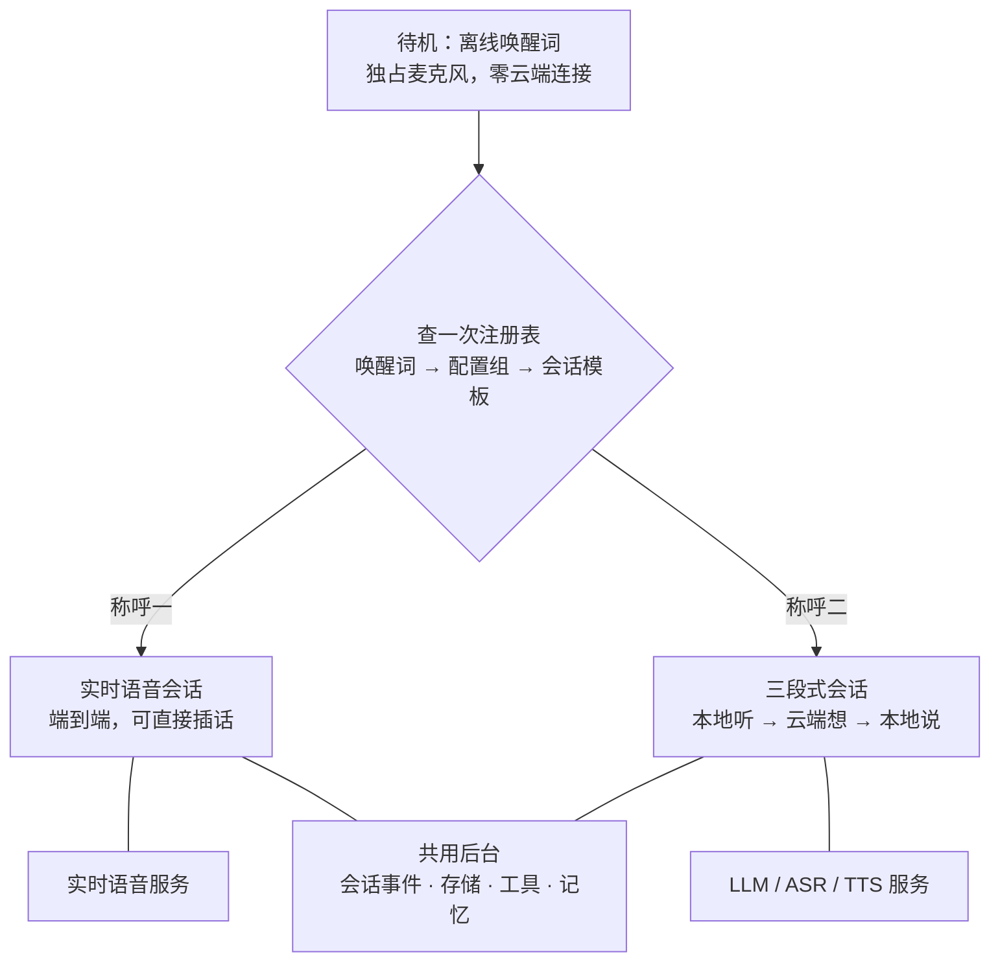
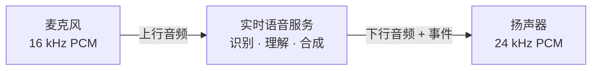
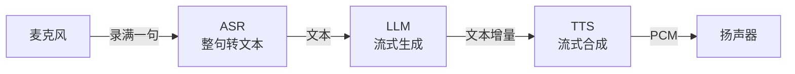

# 全双工私有语音智能体

**GitHub**：<https://github.com/BochDu/pipecat-duplex-private-agent>

一个能随时插话、数据尽量留在本地的语音助手，以及围绕它的一次项目复盘。

## 一、为什么做这个

直接原因是家里那台小爱同学。

用了几年的感受是：唤醒和放歌还行，但对话能力停在几年前——说完要等，插话要重喊，问稍微绕一点的问题就开始答非所问。更关键的是封闭：模型换不了，流程改不了，想接自己的服务、加自己的技能、让数据只走自己的通道，都没有入口。它是个成品，不是一个能改的东西。

于是想自己做一个：

- 想用什么模型就用什么模型，今天不满意，明天可以换。
- 唤醒词、打断规则、超时时间都能自己调，不用等厂商更新。
- 会话数据留在本地，云端只负责语音和模型推理。
- 跑在树莓派上，成本可控，坏了能自己修。

说白了，不是因为市面上的产品做不到，而是它们不让我按自己的方式做。

## 二、怎么设计：提示词 + 会话，而不是调度系统

### 想了很久，最后选了最简单的结构

一开始的设想是「一个助手什么都能干」：识别意图、按任务挑模型、失败自动降级、会话中途切换。画了几版调度图之后发现，越画越复杂——每加一个模型或能力，路由和状态机都要跟着改，而这些切换在对话里几乎感知不到，却引入了一堆不确定性。

最后的决定是**不做调度，用提示词搭配会话**：

- **一个唤醒词对应一次会话**，一次会话固定一条链路、一个模型，整场不变。
- **差异靠提示词和配置表达**，不靠代码分支：系统提示词定人设和说话风格，配置组定凭据、音色、音量。
- **想换就重新唤醒**：喊另一个唤醒词就是另一条链路；换模型、音色则改注册表或本地配置后重启，新会话生效，而不是会话中途切。
- **会话模板只做编排**：听、想、说怎么串，两类链路各一份，厂商差异留在适配层。

这样整条路径是线性的：待机 → 查一次注册表 → 定链路 → 跑完会话 → 回待机。状态少、失败可解释，加一个模型只改注册表，不用动路由和后台。

### 结构长这样



箭头只表示唤醒时的一次选择，横线表示通信或复用。会话开始后不再查注册表；切换模型严格「先停旧会话、再起新会话」，同一时刻只有一条会话持有麦克风。

### 换来了什么，放弃了什么

换来的是：逻辑线性、状态少、加模型不动代码、出问题能一眼看出是哪一段。放弃的是「一场会话里又闲聊又切不同模型」这种玩法——实际用下来并不需要，为了它维护一套调度器不划算。

这也是整个项目最重要的一次取舍：**把复杂度花在体验上，而不是花在架构上。**

## 三、选 API：先量延迟，再谈价格

### 两种典型形态

**形态一：端到端实时语音（一条 WebSocket）**



听、想、说全在服务端完成，一条连接从唤醒撑到会话结束。链路最短、首包最低，打断是协议内建的——发一个取消事件，服务端停止继续吐音频，本地丢掉残留缓冲即可。代价是黑盒：内部怎么断句、怎么决策看不到；按音频时长计费通常最贵；各家事件名和工具调用格式都不同，换一家适配层基本要重写。

**形态二：自己拼（ASR → LLM → TTS）**



三段各自建连、各自首包，延迟是累加的；打断要自己实现——停掉播放、取消正在进行的那一段，静默判停、播放排队也都得自己写。换来的是每段都能替换、能单独压测、成本按段算。

**放在一起看**

| | 端到端 | 自己拼 |
| --- | --- | --- |
| 连接 | 一条 WebSocket | 三段串联 |
| 首包 | 最短 | 各段首包相加 |
| 打断 | 协议内建取消 | 自己停播放并取消请求 |
| 换厂商 | 适配层要重写 | 只换其中一段 |
| 成本 | 按音频时长，通常更高 | 按段计费，更可控 |
| 可控性 | 黑盒 | 每段可观测、可替换 |

按功能拆其实只有三件事：**听**（ASR）、**想**（LLM）、**说**（TTS）。端到端把这三件打包卖给你，自己拼则是由你决定每段用谁。价格和延迟可能差几倍，先想清楚要什么，再看接口。

### 我的组合和理由

- 主对话走**端到端实时语音**：这类场景最看重首声和打断，链路越短越好。
- 需要长回答、复杂一些的问答走**三段式**：ASR + LLM + TTS，模型可换、成本低，不着急的对话更划算。
- TTS 先用免费接口跑通，音色和稳定性够用再考虑付费。
- ASR 用按句识别的接口，简单，也方便单独做回归。

一句话：**接口形态决定体验上限，模型能力决定体验下限。**

## 四、唤醒词换了三种方案

唤醒词看着是小功能，却是我最先卡住的地方。

**① Vosk 小模型**：能在树莓派上跑，内存也友好，但它本质是离线语音识别：需要非常标准的普通话，口音稍重就识别不出来；而且只能一轮一轮地识别，每次要先断句、等结果，唤醒本身就有延迟。参数怎么调，都只是在「听不见」和「乱答应」之间来回。

**② Vosk 大模型**：准确率明显上来，但这台机器连会话都没跑到——模型加载时内存直接吃满，树莓派当场重启。**模型大小必须按设备内存选，不能只看识别率，先看峰值内存再谈效果。**

**③ 商用唤醒词 SDK**：效果和资源占用都很好，但要注册账号、申请 Key、走邮箱验证，授权还和账号绑定。一个自用项目为此引入外部账号体系，不划算。

**④ 最终方案：sherpa-onnx 关键词检测**：3.3M 参数的 Zipformer 小模型，int8 导出，CPU 两线程就能跑；支持自定义拼音关键词，「大肥鱼」这种自造词不用训练；代价是关键词要手写拼音 token。加载 1~2 秒，待机期零云端连接。

**它怎么工作**：模型是 Zipformer transducer，由 encoder / decoder / joiner 三个 onnx 组成。关键词检测不经过「先识别成文字、再和词表比对」，而是把音频的 token 序列直接和关键词的拼音序列对齐，命中就报出这个词。所以自造词不需要训练，也不依赖语言模型里本来有没有这个词。

**关键词表就是它的「提示词」**：一行一个词，前面是带声调的拼音 token（空格分隔），`@` 后面是显示名：

```text
d òu b āo @豆包
d à f éi y ú @大肥鱼
```

token 必须出现在模型自带的 `tokens.txt` 里，声调写错就不会命中。旧版绑定还支持在行尾用 `:score #threshold` 单独覆盖某个词的阈值。

**运行参数**（都在 `config/defaults.env`，改完重启生效）：

```env
WAKEWORD_ENGINE=kws
WAKEWORD_KWS_DIR=data/models/kws
WAKEWORD_KWS_KEYWORDS=data/models/kws/keywords.txt
WAKEWORD_KWS_SCORE=1.0
WAKEWORD_KWS_THRESHOLD=0.25
WAKEWORD_KWS_THREADS=2
```

**代价与限制**：关键词得手写拼音；同音词容易混（「豆包」和「都报」），起名前就要想清楚；口音和语速会直接影响命中率，只能靠阈值和换词解决。命中后先交还麦克风，再建会话，所以待机期它独占设备、不联网。

三条经验：

- 在设备上选型，先看资源占用和离线可用，再看准确率；跑不动的模型，准确率再高也是零。
- 商用方案说的「免费」，经常要用账号、邮箱和额度来换，自用项目先算这笔账。
- 唤醒是体验的第一环，它不稳，后面做得再好也白搭。

## 五、目录、自检与规范

### 目录先按职责切开

```text
app/           运行时：providers 厂商适配 / sessions 链路编排 /
               audio 设备 I/O / wake 唤醒 / storage 落盘
config/        注册表与调好的默认值
preflight/     每个服务一个自包含目录：自检脚本 + README + 官方文档
tests/         关键路径回归
deploy/        systemd 单元
docs/          安装 / 维护 / 配置 / 架构，各答一类问题
```

一条规则：**厂商进 `providers`，编排进 `sessions`，验证进 `preflight`，结论进 `docs`，运行时目录不背包袱。**

### 接口测试沉淀在 preflight

`preflight/<能力>_<品牌>/` 里的每一份都含 api-check（能不能连），实时语音那份另有 downlink（下行声音对不对）和 upstream（上行有没有丢帧）；结论写进 README，报告放 `preflight/evidence/`（不入库）。

落地顺序就沿着这个目录走：**先在 preflight 跑通 → 写适配层 → 接进 sessions → 装 systemd**。每一级都有产物可检查，不用等整条链路跑起来才知道行不行。

这套沉淀有三个用处：

- 换模型时直接抄目录结构，少想一步。
- 出问题先跑对应脚本，能立刻分清是设备、接口还是编排。
- 上次的判据和证据都留着，下次不用重踩。

代价是前期多写几个脚本；但这些脚本活得比适配层长，换厂商时最先用的还是它们。

### 规范让每一步可复制

- **加模型**：注册表一条 + `providers/` 一个目录 + `.env` 一组键，路由和后台不动。
- **加链路**：`sessions/` 登记一个模板，唤醒路由不动。
- **配置**：默认值随代码、凭据放 `.env`、真实环境变量最高，密钥不进仓库。
- **改动**：动过关键路径就补一条测试，结论只写进文档，不写试错过程。

落地不是一次写完的，是每一步都留一个能验证的落点。

## 六、代码逻辑：体验是几个毫秒决定的

功能都差不多，拉开差距的是这几处：

- **采集节奏固定**：20 ms 一帧，单帧上行发送 6 s 超时就结束会话；说话判定用 RMS，底噪 200~300、人声 600+，判停阈值 900、打断阈值 1200。
- **起播前垫静音**：会话首播 150 ms，提示音与流式 TTS 300 ms，打断重开 60 ms；不垫就吞句首。
- **停声要杀进程**：aplay 的管道和 ALSA 缓冲里还有约 1.5 s 音频，清队列没用。
- **打断按持续判**：人声连续 250 ms 过阈值才算，带 0.8 s 冷却，且只在确实播着时判；自打断先解决回声，别加长门限。
- **静默只算两种活动**：用户开口、模型输出；播放余量要补进计时，默认 10 s 结束。
- **设备交接与恢复**：唤醒独占麦克风，提示音后 0.2 s 再采集；播放器退出重建、断连回待机、systemd 失败 5 s 重试。

这些数字都不来自模型，但直接决定用户听到什么。

## 七、谁有权打断谁

打断权归谁，只有四种组合：

| | AI 不能打断人 | AI 可以打断人 |
| --- | --- | --- |
| **人不能打断 AI** | 传统音箱：轮流说，等它讲完 | 最差：说到一半被它接话 |
| **人能打断 AI** | **我的选择：人优先** | 真·对聊，但容易抢话 |

我选左下：人随时能收回话筒，AI 不许抢。宁可把一声咳嗽当成插话，也不让用户等它说完；反过来，用户思考时的停顿不算说完，它不能接话、不能自续话题。代价是回答常被截断，但控制感比完整度重要。

落到代码就三条：本地起音优先于服务端判断、停声杀进程而不是清队列、说「停」整轮丢弃。

只留一个指标就留停声延迟——它决定用户觉得是在「和它说话」，还是在「等一个系统」。

---

2026-11-07，树莓派 4 + USB 会议音箱，两条链路分别接实时语音与通用大模型。
